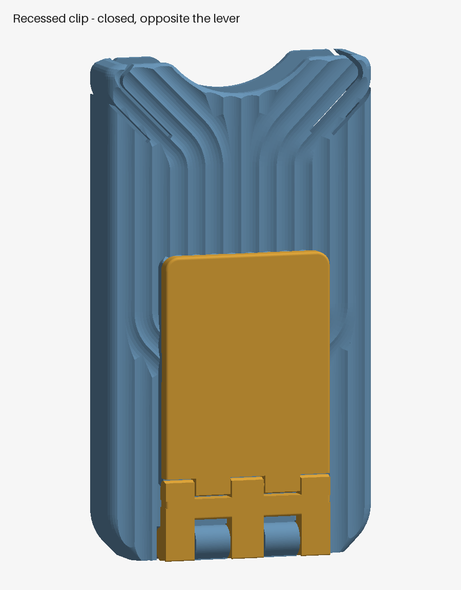
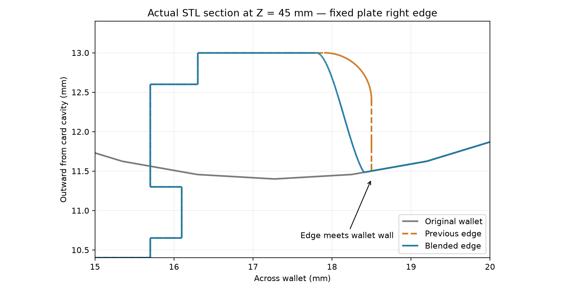
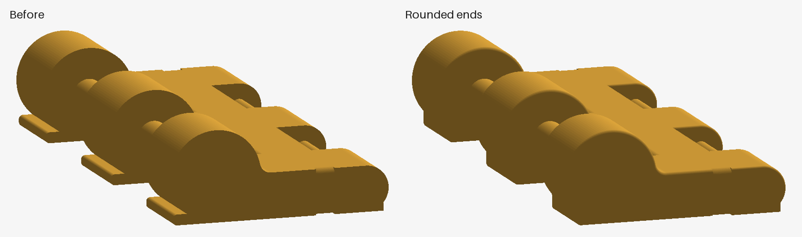

# Parametric mounting plate

A build123d plate with a downward top hook, a rounded upward lower catch,
and a release tab. All dimensions describe the part itself, in mm.
No slot height, depth, pitch, or internal wall profile is assumed.

## Parameters

| Parameter | Default | Meaning |
| --- | ---: | --- |
| width | 80 | Plate width, X |
| height | 70 | Plate body height, Z; excludes release tab |
| plate_thickness | 4 | Plate thickness, Y |
| hook_spacing | 36.5 | Clear vertical gap from top of lower straight arm to underside of upper straight arm; excludes both returns |
| hook_width | 36 | Upper hook width across X |
| hook_thickness | 2.4 | Upper arm and return thickness; also sets rounded catch depth behind its lip gap |
| hook_drop | 4 | Downward return below underside of upper straight arm |
| lip_thickness | 1.5 | Clear gap behind plate to inside of upper return; also locates lower curve's inner shoulder |
| snap_width | 16 | Lower catch and tongue width across X |
| snap_thickness | 1.8 | Lower straight arm and flexible tongue thickness |
| snap_length | 28 | Vertical distance from top of lower arm to tongue root |
| snap_peak | 1.2 | Rounded crown height above top of lower straight arm |
| release_gap | 1 | Clearance on each side of tongue |
| release_tab_length | 0 | Extension below plate; zero leaves tab flush, with grip present |
| release_grip_radius | 2 | Rounded finger crossbar radius |

`hook_spacing` is **not centre-to-centre**. For example, the 36.5 mm gap does
not include either arm's thickness, the 4 mm downward return, or the 1.2 mm
upward crown. Changing either return leaves that gap unchanged. The two
straight arms together are centred vertically on the plate.

`lip_thickness` is the actual gap in the model, with no hidden fit allowance.
Add any desired printing allowance to this value yourself. The lower catch's
rear projection is derived as `lip_thickness + hook_thickness`; its rounded
Bezier shoulders scale with that depth and `snap_peak`.

## Run and export

```sh
python -m pip install -r requirements.txt
python slatwall_plate.py
python -m unittest discover -s tests -v
```

Exports `output/slatwall_plate.step` and `.stl`.

## OCP CAD Viewer

Install the OCP CAD Viewer extension in VS Code and its Python bridge:

```sh
python -m pip install ocp-vscode
```

Run `view_plate.py`. Its `PlateParameters(...)` call lists all editable
parameters. The viewer is optional for export and tests.

## Combine with another model

```python
from slatwall_plate import PlateParameters, make_plate

plate = make_plate(PlateParameters(hook_spacing=36.5, snap_peak=1.2))
# combined = plate + accessory
```

X runs across the plate, Z points up, and Y points away from its back.
The plate back is Y=0, front mating face is Y=plate_thickness, and hooks
project into negative Y. Keep the flexible tongue and its front travel clear;
do not bridge its relief slots with the accessory.

## Release and printing

With `release_tab_length=0`, the tab ends flush with the plate bottom and
retains its rounded grip on the front. Increase it to extend the tab below
the plate (for example, `release_tab_length=12`). Pull its rounded crossbar outward (+Y) to flex the lower catch clear,
then tilt the bottom away and lift the top hook off. Leave access to the tab
when adding an accessory. The grip stays within the tongue width, so it does not bridge the side
relief gaps, including when tab length is zero.

For PLA on your Bambu A1, test the fit and release before adding a large
accessory. Check layer orientation at the tongue root and keep support scars
off the hook surfaces. Reduce `snap_peak` or adjust tongue thickness/length
if the snap needs excessive force. CAD checks verify solid geometry, not
release force, fatigue, load capacity, or compatibility with a particular wall.

## Articulated magnetic money clip

```sh
python magnetic_money_clip.py
python magnetic_money_clip.py --view
python magnetic_money_clip.py --view --view-state closed
python magnetic_money_clip.py --view --view-state cash
```

Viewing requires `ocp-vscode` and the VS Code OCP CAD Viewer extension.
The clip now has a **61.8 mm reach**, about 1.5 times the previous 41.2 mm,
and **two rows of four 10 × 5 × 2 mm bar magnets per jaw** (16 magnets total).
Both plates are now **37 mm wide**, with both hinge spans widened to match.
The bars are parallel; row centres are at 27 and 49 mm, with 9 mm spacing
across the width. All pockets load from the money-facing side, including
from the top of the flat closing plate. The wallet-facing back stays smooth.

The jaws are **parallel**, with no inward cant. A **second captive hinge at
12 mm from the original pivot** divides the bottom jaw into a short root link
and a magnet-bearing closing plate. Together, the two joints let the closing
plate lie parallel against different money thicknesses. The extra hinge is
before the magnet pockets; adding joints between the current pocket rows
would require more space and reduce the uninterrupted clamping area.

The `cash` viewer state shows a 15-degree root rotation and the opposite
rotation at the second joint: about **3.0 mm of parallel clearance** for money.
It is an inspection STEP of the three articulated pieces without caps, not
a printing orientation. The `closed` state shows the empty assembly with
all 16 caps installed.

Jaw thickness remains **3.6 mm**: a 2 mm magnet, 1.0 mm flat protective
back skin, a uniform 0.4 mm cap and 0.2 mm total installation clearance.
Each magnet has its own pointed snap cap (20.3 × 7.65 mm overall), with
0.9 mm walls, 0.8 mm split slots and 0.10 mm snap interference per side.
The **whole flat cover is 0.4 mm thick**, including its outer flange;
there is no thick raised rim, rectangular stop or separate spacer in the
magnet cavity. The insert is **2.4 mm tall overall**, with the same tab wall
thickness. Its **0.4 mm deep seat** holds the outer surface flush with the
plate. A continuous flat pocket floor holds the magnet near the thin cover,
with 0.1 mm clearance at each face. Print these inserts with the updated
plates: old 0.8 mm seats and old snap-groove positions do not give this fit.
The thinner face needs a physical strength check; magnetic pull has not
been measured.
The 10.3 × 5.3 mm skirt interior allows installation clearance. Trial-fit one
cap before assembling all 16; no glue is required for magnet retention.

Exports into `output/`:

- `money_clip_print_in_place.stl` and `.step`: three captive articulated
  pieces plus 16 loose caps, all in their printing positions.
- `money_clip_magnet_cap.stl` and `.step`: one spare cap.
- `money_clip_closed.step`: assembled empty clip with caps installed.
- `money_clip_cash.step`: parallel-jaw articulation example without caps.

Print the main STL **as oriented**: the wallet jaw upright at 90 degrees,
root link and closing plate flat, caps flange-down with split skirts up.
The primary hinge retains its 2.4 mm printed axle. The second hinge fits
within the plate thickness: 3.6 mm barrel diameter, **1.2 mm printed axle**,
1.8 mm bore and **0.9 mm bearing walls**. Both joints have 0.30 mm radial
and 0.35 mm axial clearances. The smaller axle must be physically tested
for strength and cycling before wallet use; CAD does not establish durability.

Pointed pocket roofs close at 45 degrees on the upright jaw. Its lower
body edge has four slopes about 42 degrees from vertical, eliminating the
old flat underside ledges. The curved hinge transition and flat bed lands
remain. Caps print flat with gradual ridges below 45 degrees. Horizontal
hinge bores/pins and the flat plate's pocket roofs still contain short bridges:
inspect those in the slicer and keep supports and brim out of hinge gaps,
snap grooves and cap slots. A brim can help the upright jaw. Support-free
printing has not been physically verified.

After cooling, gently free both hinges. Confirm magnet polarity before
pressing each cap flush from the money-facing side. Attraction loads these
caps outward, so test pull-out retention with the actual magnets before
attaching the back to a wallet. Wallet attachment hardware is not included.
Printed snap force, grip strength and fatigue life all need physical testing.

Geometry tests check separate valid solids, both hinges' sampled motion,
parallel cash configurations, bed contact, pocket/cap fit, mechanical cap
capture, printable wall thickness, flush seating, and roof slopes.

Both plates have 0.6 mm rounded outer face rims in addition to their 3 mm
outline corners. The rims are rounded before pocket cuts and hinge assembly,
so cap seats, articulation clearances and underside support slopes stay intact.

The bottom closing plate has three shallow fingertip bowls on its money-facing
surface: one centred on each long side and one on the free end. Each is
9 mm wide, reaches 1.8 mm inward, and is at most 1 mm deep. They give a
fingertip or nail purchase between the plates without changing the wallet
jaw, hinge geometry or magnet pockets. The recess floors retain at least
2.6 mm of plate thickness.

## Cascade wallet with recessed clip

The supplied `Cascade card wallet V3 - no money clip.stl` is kept unchanged
at `assets/cascade_card_wallet_v3_no_clip.stl`. The ready-to-print merged
model is [models/cascade_wallet_with_clip_print.stl](models/cascade_wallet_with_clip_print.stl).



The clip attaches to the **+Y back face, opposite the card lever**. Its fixed
plate is fused into the shell, with the old wall cut out of the magnet seats
and a clearance recess around the primary hinge. The original card-facing
back-wall boundary at **Y=9.4 mm** is preserved: newly added material does
not enter the card cavity. The original card-lifting mechanism is retained
as a separate, unchanged part. The small rear bulge of the clip's root web
is trimmed flush with that boundary.

The fixed money-facing surface is **1.1 mm beyond the original back**.
With the empty clip closed, it extends **4.7 mm beyond the original back**;
the complete closed assembly is approximately **60 × 20.6 × 106.5 mm**.
The fixed plate's two side rims and top rim now curve down into the original
wallet wall, so those outer edges meet the wall surface. Only the perimeter
is thinned: the magnet seats, cap collars and both hinges retain their
previous geometry. The moving plate is unchanged. Magnet regions remain
about 1.1–1.6 mm proud of the surrounding back, depending on the original
ribs; this does not make the entire fixed plate face flush. The empty closed
clip's maximum protrusion is still 4.7 mm.

The side blends occupy up to 0.7 mm of the rim and the top blend up to
1.5 mm. These widths shrink automatically if needed to preserve at least
0.35 mm of full-height material outside the cap-seat outlines. The existing
wallet wall supports the blends. Deeper recessing at the magnet areas would
require thinner pocket floors or thinner magnets.


The back wall is only 2–2.5 mm thick, so recessing farther with the current
clip would intrude into the card/mechanism space. About 1,476 mm³ of old
shell material is removed, primarily from magnet pockets and hinge clearance.

Import the print STL **as one assembly and keep every part's relative
position**. The wallet stays upright, the moving clip pieces lie flat, and
16 caps are laid beside it. All 20 connected components start on the bed;
the footprint is approximately 60 × 196 mm. Do not auto-arrange the wallet
mechanism or the moving clip parts separately. Preserve the original
print-in-place gaps; inspect the slicer before printing and avoid support
material inside the card mechanism, clip hinges, or snap grooves.

To regenerate or test the merge:

```sh
python -m pip install -r requirements-wallet.txt
python merge_wallet_clip.py
python merge_wallet_clip.py --view
python merge_wallet_clip.py --view --view-state closed
python -m unittest discover -s tests -p test_wallet_merge.py -v
```

Viewing requires `ocp-vscode` (`python -m pip install ocp-vscode`) and the
VS Code OCP CAD Viewer extension. `--view` rebuilds and displays the exported
print STL; `--view --view-state closed` displays the closed inspection STL.
The viewer loads a mesh reference, so it shows the actual exported result
without converting every triangle to an editable CAD face.

This is a measured fit for this exact source STL. The script checks its hash
and dimensions; a different wallet version requires new measurements.
The extra mesh dependencies are separate from the standalone CAD requirements.
Mesh booleans join only the fixed clip to the shell. Micron-scale collapsed
facets at the fingertip bowl poles are cleaned during STL tessellation;
no holes are filled and no mechanism geometry is repaired or altered.

Outputs in `output/wallet_merge/` include the print STL, individual component
STLs, `merge_report.json`, and `cascade_wallet_clip_closed_preview.stl`.
The closed file is **for inspection only**, not printing: its nominally
contacting plate and cap faces overlap at zero clearance. The report checks
that magnet chambers/cap seats are open, that the card mechanism remains
clear, and that both clip pieces clear the shell at sampled angles, including
a roughly 3 mm cash configuration. Full physical card-lever actuation,
print tolerances, magnetic holding force and fatigue still need a print test.

The card-space trim uses a true plane at Y=9.4 mm, without an oversized
cutting box. The merger remains a measured fit for the supplied wallet STL.

The primary hinge barrel end rims have **0.3 mm roundovers**, and the small
second hinge has **0.2 mm roundovers**. The bore diameters, printed pins and
axial face positions stay unchanged. The main bearing spans retain their
original wall thickness; the end rims have a short rounded lead-in.
Printing pads now meet the barrel curves at one-third of their radius height,
removing the previous projecting lips while retaining a flat bed-contact
land. Their widths follow the barrel radii rather than protruding beyond them.


